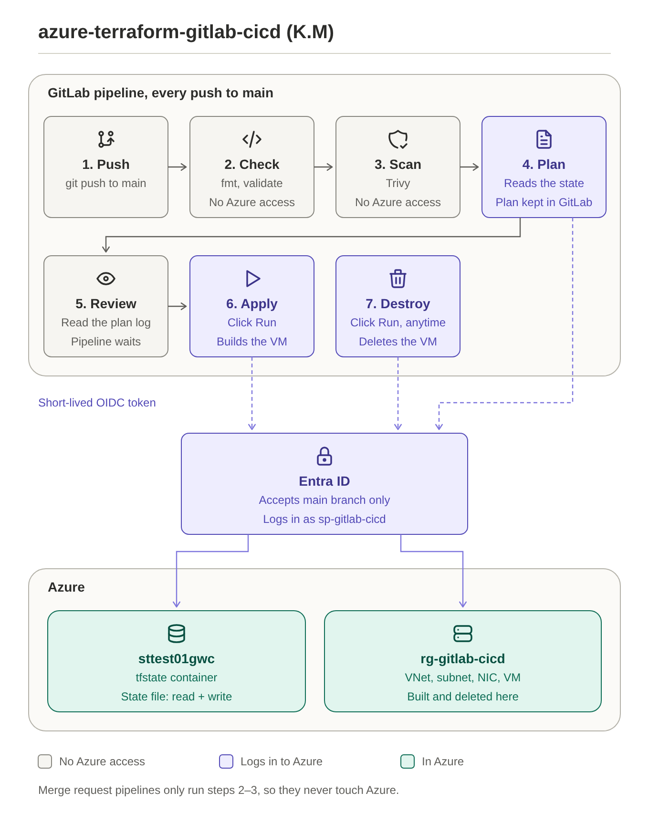

# Introduction

A simple Azure IaC project using Terraform and GitLab CI/CD. Terraform defines the infrastructure (virtual network, subnet and Linux VM) as code, and GitLab CI/CD deploys it: every push to `main` is checked, scanned and planned, then deployed only after a manual approval.

The project is based on RekhuGopal's [azure-iac](https://gitlab.com/RekhuGopal/azure-iac) tutorial. While following it, I researched what could be improved and focused on what his version was missing: *security*. The main changes are listed under Improvements over the Original.

The pipeline runs on my [GitLab](https://gitlab.com/emlykf/azure-terraform-gitlab-cicd). 

See also: [01-building-scalable-infrastructure](../01-building-scalable-infrastructure)

## Improvements over the Original

- **Secretless login (OIDC):** The original pipeline logged in to Azure with a client secret stored in GitLab. My version uses OIDC with a federated credential, so there's no secret to leak or rotate, and Azure only trusts tokens from this project's `main` branch.

- **Least-privilege identity:** The pipeline has its own identity with Contributor on the project resource group only, plus access to the state file. It can't touch anything else in the subscription.

- **Secured remote state:** Instead of an existing storage account accessed with a storage key, the state lives in its own storage account with key access disabled, so only Entra ID logins work. Versioning and soft delete let me restore it if needed.

- **Hardened VM:** The original Windows Server 2016 VM had its password written in the code. My version uses Ubuntu 24.04 LTS with SSH key login only, Trusted Launch and no public IP.

- **Pinned versions:** Instead of `terraform:latest` and an unpinned provider, Terraform 1.17.2 and azurerm 5.x are pinned, and the lock file is committed, so updates can't break the pipeline unexpectedly.

- **Security scan:** Trivy scans the Terraform code before every plan and stops the pipeline on HIGH or CRITICAL findings.

- **Stronger branch protection:** `main` is protected, pipeline variables are blocked, and merge request pipelines get no Azure access. Only reviewed code on `main` can deploy.

- **Safer deployment:** The apply job uses exactly the saved plan I reviewed, only one apply or destroy can run at a time, and a manual destroy job removes everything with one click.

- **Bootstrap scripts:** Two scripts set up the state storage and the pipeline identity, replacing a list of manual commands. Both are safe to run again.

## Challenges & How I Resolved Them

- **VM size available, but not allowed:** The first apply failed because my subscription had a quota of 0 cores for the B-series, even though the size was offered in the region. I compared the available sizes with my quotas using the Azure CLI and switched to `Standard_D2s_v3`, which has both.

- **Cache brought Azure settings into the wrong job:** After the first apply, the validate job suddenly tried to connect to Azure and failed. GitLab's shared cache had carried Terraform's backend settings from the plan and apply jobs into it. I turned off the cache for the validate job, so it always starts clean.